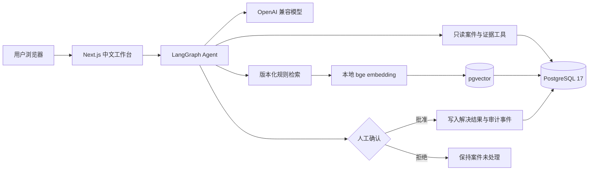
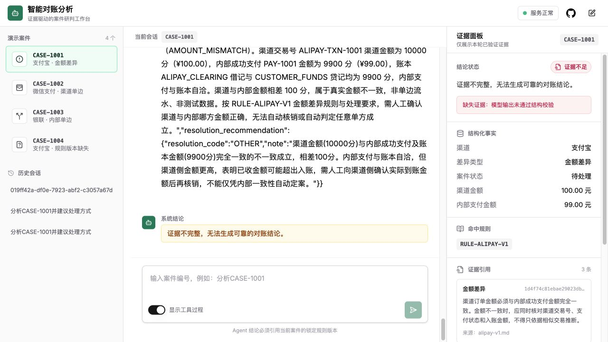
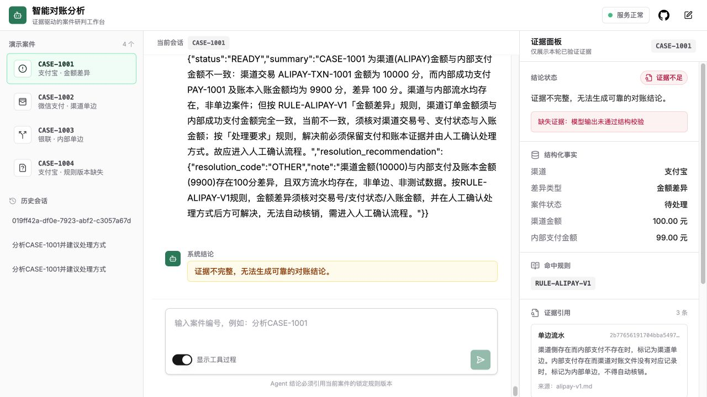

# 智能对账分析 Agent

[](https://github.com/32694/ledger-reconciliation-agent/actions/workflows/ci.yml)

## 项目定位

这是一个独立的智能对账分析演示项目：LangGraph Agent 读取案件、支付和账本事实，通过版本化 RAG 检索案件锁定的规则版本，形成带证据引用的处理建议，并在任何写入前等待人工确认。

仓库只包含固定的合成数据，不连接真实支付渠道，不处理真实资金，也不宣称具备生产级部署能力。它与任何 Java 对账仓库相互独立，不要求先构建或运行 Java 项目。

## 核心能力

- **证据约束分析**：案件事实、支付记录和账本记录只能由只读工具获取；缺少必要证据时返回“证据不足”，不补写推测。
- **语义一致性校验**：后端校验支付状态、渠道交易号、支付金额、账本借贷平衡和账本金额一致性；结构化证据矛盾时确定性拒答。
- **版本化 RAG**：严格使用案件记录中的 `rule_version` 检索规则，不回退到其他版本；规则引用保留版本、章节和 chunk 标识。
- **本地向量检索**：`BAAI/bge-small-zh-v1.5` 在本地生成 embedding，向量保存在 PostgreSQL 的 pgvector 扩展中。
- **人工确认写入**：分析与建议不会直接改变案件；只有用户在一次性确认窗口中批准后，才写入解决结果和审计事件。
- **可审计运行**：工作流保存案件状态、工具结果、引用、确认和最终处理记录。
- **固定评测**：无 Key 的 CI 使用 scripted model 运行确定性评测。它只服务于自动化测试，不是在线推理模型的替代品。

## 架构



安全边界有三层：交易事实不交给模型编造，规则检索锁定版本，写操作必须经过人工确认。embedding 在本地运行，但在线 Agent 推理仍需要一个真实、可用的 OpenAI 兼容模型服务。

## 三分钟演示

1. 复制配置并在本机填写真实模型连接信息：

   ```bash
   cp .env.example .env
   # 编辑 .env：填写 MODEL_BASE_URL、MODEL_API_KEY、MODEL_NAME
   ```

2. 启动数据库、Agent 和 Web：

   ```bash
   ./scripts/start.sh
   ```

3. 打开 `http://localhost:3000`，选择 `CASE-1001`，发送“分析 CASE-1001 的差异原因”。在右侧“证据面板”核对结构化事实、锁定规则版本和证据引用；看到“等待人工确认”后选择“确认执行”或“拒绝执行”。选择 `CASE-1004` 可观察规则版本缺失时的“证据不足”路径。

## 界面预览

下面的截图来自本地配置的 `deepseek-chat` 真实模型验收，使用仓库内合成案件数据。

### 分析工作台



模型实际调用了案件、支付、账本和规则工具，页面展示了结构化事实、规则版本 `RULE-ALIPAY-V1` 和证据引用。

### 解决请求的安全降级


对解决请求的响应没有通过应用的严格结构化输出校验，系统因此保持“证据不足”，没有显示批准或已解决状态。

### 案件仍保持未解决



这张图记录了安全拒绝后的界面状态，不代表案件已经解决。只有结构化结论完整且人工确认通过，系统才允许执行写操作。

完整操作见 [用户指南](docs/USER_GUIDE.md)。

## 技术栈

| 层级 | 实现 |
| --- | --- |
| Agent 工作流 | Python 3.12、LangGraph、LangChain |
| 模型接口 | OpenAI-compatible Chat Completions |
| 规则检索 | `sentence-transformers`、`BAAI/bge-small-zh-v1.5`、版本化 RAG |
| 数据库 | PostgreSQL 17、pgvector、SQLAlchemy、Alembic |
| Web | Next.js 15、React 19、TypeScript |
| 交付与验证 | Docker Compose、pytest、Ruff、mypy、Vitest、GitHub Actions |

## 快速启动

前置条件：Docker（含 Compose 插件）和 Git。首次启动会构建镜像并下载本地 embedding 模型，所需时间取决于网络和 Docker 缓存。

```bash
git clone https://github.com/32694/ledger-reconciliation-agent.git
cd ledger-reconciliation-agent
cp .env.example .env
```

编辑根目录 `.env`，至少填写：

```dotenv
MODEL_BASE_URL=https://your-openai-compatible-provider.example/v1
MODEL_API_KEY=your-local-api-key
MODEL_NAME=your-model-name
```

密钥只保存在本机 `.env`，不要提交到 Git。然后运行：

```bash
./scripts/start.sh
```

启动成功后访问 `http://localhost:3000`；Agent API 位于 `http://localhost:2024`。停止服务使用 `./scripts/stop.sh`，停止不会删除数据库或模型缓存 volume。

### 可选：读取 Java 平台证据

Agent 默认使用自己的 `ledger_agent` 合成数据库。需要组合两个项目时，在 `.env` 中切换只读证据源：

```dotenv
EVIDENCE_PROVIDER=java
JAVA_PLATFORM_BASE_URL=http://host.docker.internal:8080
JAVA_PLATFORM_READ_API_KEY=与 Java 的 APP_READ_API_KEY 相同
JAVA_CASE_ID_MAP={"CASE-1001":{"result_id":"Java 返回的 resultId UUID","channel":"ALIPAY","rule_version":"RULE-ALIPAY-V1"}}
```

Agent 容器访问宿主机上的 Java 服务使用 `host.docker.internal`，不能写 `localhost`。两个项目仍使用各自数据库；Java API 只读，Agent 不会直接访问 Java PostgreSQL。`JAVA_CASE_ID_MAP` 必须显式维护案件编号、Java `resultId`、渠道和规则版本，映射缺失会返回 `CASE_NOT_FOUND`。

## 无 Key 验证

完整质量门禁不读取根 `.env`，也不调用真实模型：

```bash
./scripts/verify.sh
```

脚本会在隔离的 Compose project 中运行 Python 检查、集成测试、scripted model 评测、前端测试、类型检查和生产构建。结果写入 `artifacts/`，测试容器与测试 volume 在结束时清理。无 Key 验证通过不代表在线模型连接已验收。

## 目录结构

```text
agent/                  LangGraph 工作流、领域模型、RAG、工具、迁移与测试
web/                    Next.js 中文工作台与前端测试
docs/                   用户指南、迁移指南和设计记录
scripts/                启停、验证、数据库备份与恢复脚本
compose.yaml            长期运行与隔离验证服务定义
.env.example            根级本地配置模板
THIRD_PARTY_NOTICES.md  上游项目和许可证说明
```

- [用户指南](docs/USER_GUIDE.md)
- [迁移指南](docs/MIGRATION.md)
- [Agent 开发说明](agent/README.md)
- [Web 开发说明](web/README.md)

## 当前限制

- 只提供合成案件、合成交易、合成账本和演示规则；结果不能用于真实资金决策。
- 本地 embedding 不等于本地大模型。实时 Agent 推理必须配置真实 OpenAI 兼容模型，离线 scripted model 仅用于测试。
- 当前交付面向本地单机演示，没有高可用、租户隔离、生产密钥托管、灾备演练或支付系统接入。
- 自动化测试验证固定数据和安全边界，但不能替代真实模型的本机端到端验收。

## 上游来源与许可证

后端基于 MIT 许可的 [langchain-ai/react-agent](https://github.com/langchain-ai/react-agent) 模板改造；前端基于 MIT 许可的 [langchain-ai/agent-chat-ui](https://github.com/langchain-ai/agent-chat-ui) 改造。本仓库新增对账领域模型、证据工具、版本化规则 RAG、人工确认、运行审计、固定评测和中文业务界面。

项目代码使用 [MIT License](LICENSE)。固定的上游 commit、原许可证保留位置和改造范围见 [THIRD_PARTY_NOTICES.md](THIRD_PARTY_NOTICES.md)。
