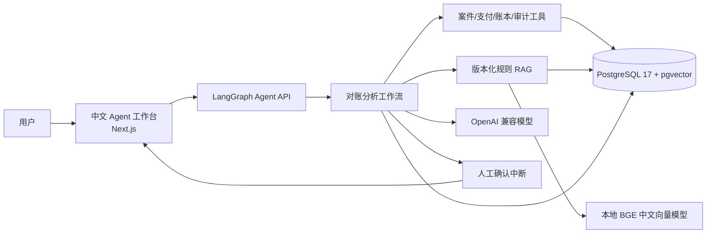

# 对账分析 Agent 独立交付与运行收尾设计

日期：2026-08-11

## 1. 背景

仓库已经实现对账案件分析所需的 LangGraph 工作流、证据查询工具、版本化规则 RAG、PostgreSQL/pgvector 持久化、人工确认、运行审计、固定评测和中文工作台。正式 `main` 为 `ffc217b`，本地与远端一致。

当前缺口集中在交付层：根目录没有 README，后端和前端 README 仍以原始模板为主；环境变量示例与实际 `Settings` 不一致；GitHub Actions 工作流位于子目录，GitHub 不会执行；缺少根级 Docker Compose、一键验证、启动、备份、恢复和迁移说明；真实模型尚未完成端到端验收。

本阶段把现有核心能力整理成可独立克隆、验证、启动、演示和迁移的 Agent 项目，不重新设计已经通过测试的业务工作流。

## 2. 仓库隔离

本阶段只允许修改 Git 仓库 `ledger-reconciliation-agent`：

```text
/Users/fanyi32694/Documents/Codex/2026-08-07/wo-x/outputs/ledger-reconciliation-agent
```

Java 仓库 `ledger-reconciliation-platform` 保持 `main=4729213`，不得修改、提交、复制代码或直接访问其 PostgreSQL 数据库。Agent 不依赖 Java REST API；未来接入只能通过独立 HTTP 适配器完成，不属于本阶段。

为避免本机冲突，Agent 使用以下端口：

- 中文工作台：`3000`
- LangGraph Agent API：`2024`
- PostgreSQL/pgvector：`5433`

Java 项目继续使用 `8080`、`5432` 和 `5672`，两套服务可以同时运行。

## 3. 目标

- 根目录提供正式中文 README，准确说明项目定位、核心能力、RAG、人工确认、安全边界、技术栈和上游来源。
- 只安装 Git 和 Docker Desktop 的新电脑可以按手册完成构建、验证和启动。
- 无模型 API Key 时可以运行单元测试、数据库集成测试、固定评测和前端测试。
- 配置真实 OpenAI 兼容模型后，可以从中文工作台完成一次案件分析和人工确认闭环。
- GitHub Actions 在仓库根目录执行后端、数据库、评测和前端检查，不依赖付费模型或外部搜索服务。
- PostgreSQL 数据可以通过明确脚本备份和恢复，配置、密钥和备份文件不进入 Git。
- README 使用真实中文页面截图和可重复的三分钟演示说明，而不是模板宣传材料。

## 4. 非目标

- 不接入或修改 Java 项目，不实现 Java REST API 客户端。
- 不增加 Kafka、RabbitMQ、Redis、Kubernetes、微服务拆分或多租户。
- 不把 scripted model 包装成真实大模型能力；它只用于自动化测试和固定评测。
- 不在 CI 调用真实模型、LangSmith、Tavily 或其他收费/外部服务。
- 不训练或微调模型，不构建通用知识库平台。
- 不承诺生产级 LangGraph 部署、高可用、监管合规或真实资金处理。
- 不重写现有前端设计系统或已通过验收的 Agent 业务工作流。

## 5. 总体架构

仓库继续保留两个独立应用目录：

- `agent/`：Python 3.12、LangGraph、LangChain、SQLAlchemy、Alembic、pgvector、sentence-transformers。
- `web/`：Next.js、React、TypeScript、Agent Chat UI 和现有中文对账展示组件。

根级 Docker Compose 编排三个长期服务：

1. `postgres`：基于 PostgreSQL 17 与 pgvector 扩展，保存合成业务证据、规则向量、Agent 运行记录、解决记录和审计事件。
2. `agent`：启动前执行 Alembic migration、合成数据初始化和规则向量导入，然后运行 LangGraph 本地 Agent API。
3. `web`：构建并运行 Next.js 工作台，通过 `NEXT_PUBLIC_API_URL` 连接 Agent API。

请求链路：



模型负责基于证据决定工具调用和组织结论；事实、规则、状态修改和审计结果由确定性工具和数据库约束控制。解决案件必须经过 LangGraph interrupt，批准后只写指定案件一次，拒绝不写业务状态。

## 6. RAG 与模型边界

规则 RAG 保留现有实现：

- 规则源文件位于 `agent/knowledge/rules/`。
- 本地 `BAAI/bge-small-zh-v1.5` 生成 512 维归一化向量。
- pgvector 保存规则 chunk 和 embedding。
- 检索必须锁定案件记录中的 `rule_version`，不得使用其他版本的规则替代。
- Agent 输出引用 `chunk_id`、来源、章节和规则版本。
- 缺少案件、支付、账本、审计或匹配规则时，返回证据不足，不生成确定性归因。

本地 embedding 不使用模型 API，但首次构建或首次导入规则时需要下载 Hugging Face 模型。Docker 使用命名缓存卷保存模型文件，避免每次启动重复下载。

正式运行使用现有 `ChatOpenAI` OpenAI 兼容接口，通过以下必填配置选择供应商：

- `MODEL_BASE_URL`
- `MODEL_API_KEY`
- `MODEL_NAME`

scripted model 继续只存在于测试和评测路径。没有 API Key 时，验证脚本必须通过，但交互式 Agent 服务不得伪装成已经完成真实模型分析。

## 7. 配置与密钥

根目录新增 `.env.example`，只列出项目真实读取或 Compose 需要的变量：

- PostgreSQL 数据库名、用户名和密码。
- 模型 base URL、API Key、模型名、超时、最多重试次数和工具调用预算。
- embedding 模型名与 Hugging Face 缓存目录。
- 前端 Agent API URL。
- 可选 LangSmith tracing 配置，默认关闭。

根 `.env` 继续被 `.gitignore` 忽略。`MODEL_API_KEY` 不写入镜像、README、日志、截图、测试 fixture 或 GitHub Actions。启动脚本只检查变量是否非空，不打印密钥值。

`agent/.env.example` 改为指向根级配置或与根配置保持一致，不再保留 Anthropic、Fireworks、Tavily 等上游模板变量。Agent 当前业务不需要 Tavily。

## 8. 一键启动与验证

根目录新增 `scripts/`：

- `scripts/start.sh`：检查 Docker、`.env` 和模型配置，执行 `docker compose up --build -d`，等待数据库、Agent API 和工作台健康后输出访问地址。
- `scripts/stop.sh`：停止服务但保留数据库和模型缓存 volume。
- `scripts/verify.sh`：启动隔离的 pgvector 测试服务，执行 Alembic migration、全部 Python 测试、固定评测、Ruff、mypy、前端 Vitest、TypeScript 和生产构建；不读取真实模型 API Key。
- `scripts/backup.sh`：使用 `pg_dump` 生成带时间戳的自包含备份文件。
- `scripts/restore.sh`：只接受明确的备份文件路径，验证文件存在后恢复 Agent 数据库，并提示恢复会覆盖当前 Agent 数据。

脚本使用 `set -euo pipefail`，从脚本自身位置解析仓库根目录，不依赖调用者当前工作目录。脚本不操作 Java 仓库、用户主目录或未解析的宽泛路径。

备份默认写入根目录 `backups/`，该目录加入 `.gitignore`。停止服务默认不删除 volume；删除数据必须由用户显式执行 Docker volume 操作，不在普通脚本中提供隐式清理。

## 9. Docker 设计

新增根 `compose.yaml`、`agent/Dockerfile`、`web/Dockerfile` 和必要的 `.dockerignore`：

- 后端镜像按 `agent/uv.lock` 安装锁定依赖，运行用户不是 root。
- 前端使用多阶段构建，只把 Next.js standalone 运行产物放入最终镜像。
- PostgreSQL 使用支持 pgvector 的 PostgreSQL 17 镜像和健康检查。
- Agent 只有在数据库健康后启动；Web 只有在 Agent 健康后启动。
- 数据库和 Hugging Face 缓存使用命名 volume。
- 数据库只绑定本机 `127.0.0.1:5433`，不对局域网开放。
- Agent API 和 Web 面向本机开发演示，不声明为生产部署。

数据库初始化顺序保持幂等：Alembic 升级到 head、`seed` 使用既有幂等仓储逻辑、规则导入按 chunk 标识 upsert。重复运行 `start.sh` 不生成重复案件、规则或解决记录。

## 10. CI 设计

新增仓库根 `.github/workflows/ci.yml`，替代无法被 GitHub 识别的 `agent/.github/workflows/` 和 `web/.github/workflows/`。旧子目录工作流在新 CI 验证后删除，避免维护两套失效配置。

根 CI 在 push 到 `main` 和 pull request 时执行：

1. 启动 PostgreSQL 17 + pgvector service，创建独立测试数据库。
2. 安装 Python 3.12 与 `uv`，按 `agent/uv.lock` 同步依赖。
3. 执行 Alembic migration。
4. 运行全部 `agent/tests`，数据库集成测试不得因缺少 `TEST_DATABASE_URL` 跳过。
5. 运行 scripted evaluation，并保存机器可读结果作为构建 artifact。
6. 执行 Ruff 格式/静态检查和严格 mypy。
7. 安装 Node 与 pnpm，按 lockfile 安装前端依赖。
8. 执行 Vitest、`tsc --noEmit` 和 Next.js production build。

CI 使用无效但非空的模型配置满足配置解析，所有测试通过依赖注入的 scripted/fake model，禁止发起真实模型请求。真实模型端到端测试只在本机人工验收中执行。

## 11. 文档与展示

根 README 使用中文，按以下顺序组织：

1. 项目名称、CI badge、项目定位和合成数据边界。
2. 两到四张真实中文工作台截图。
3. 核心能力：证据约束、版本化 RAG、工具调用、人工确认、运行审计和固定评测。
4. Mermaid 架构图与关键安全边界。
5. 三分钟演示。
6. 技术栈、快速启动、无 Key 验证、目录结构和文档入口。
7. 当前限制、上游来源、许可证和第三方声明。

新增：

- `docs/USER_GUIDE.md`：环境准备、模型配置、启动、案件分析、批准/拒绝、查看引用和常见错误。
- `docs/MIGRATION.md`：新电脑迁移、代码克隆、模型缓存说明、数据库备份/恢复、版本升级和回滚边界。
- `docs/images/`：真实页面 PNG，不使用外部图床。

截图只允许合成案件、合成管理员和规则数据，不得出现 API Key、Cookie、真实人员、公司信息、本机绝对路径或浏览器私人信息。真实模型完成端到端验收后再生成最终截图；在此之前不得提交占位图片。

`agent/README.md` 和 `web/README.md` 缩减为子项目开发说明，并链接根 README；不再把项目描述成未修改的 LangGraph ReAct Agent Template 或 Agent Chat UI。

## 12. 上游与许可证

保留根 `LICENSE` 和 `THIRD_PARTY_NOTICES.md`。README 明确：

- 后端基于 `langchain-ai/react-agent` 的 MIT 模板改造。
- 前端基于 `langchain-ai/agent-chat-ui` 的 MIT 项目改造。
- 本项目新增对账领域模型、证据工具、规则 RAG、人工确认、运行审计、评测和中文业务界面。

不删除上游版权声明，不把模板原作者信息冒充为当前项目作者，也不把当前实现描述为从零开发 LangGraph 或 Agent Chat UI。

## 13. 测试策略

当前无数据库基线：

- Python：`73 passed, 42 skipped`，跳过项主要依赖 `TEST_DATABASE_URL`。
- 前端：`10 passed`，TypeScript 检查通过。

本阶段验收必须补齐：

- 配置、脚本参数、错误信息和路径解析单元测试。
- Compose 配置静态验证。
- PostgreSQL/pgvector migration、seed、RAG、分析工作流和解决工作流集成测试。
- scripted evaluation 的阈值和机器可读报告。
- 前端已有单元测试、类型检查和生产构建。
- 一次真实模型手工端到端验收，记录模型名称和配置边界，不保存 Key 或完整敏感请求。

自动化测试不以真实模型输出文本逐字匹配为通过条件；固定评测使用 scripted model，校验证据完整性、规则版本、引用、工具预算、人工确认和副作用。

## 14. 实施阶段

为控制风险，分四个可独立提交的阶段实施：

1. **可移植运行基础**：根配置、Docker、Compose、启动/停止、备份/恢复、脚本测试。
2. **自动化质量门禁**：根 CI、数据库集成测试启用、无 Key 验证和评测 artifact。
3. **文档与仓库收尾**：根 README、用户手册、迁移手册、子项目 README、上游说明。
4. **真实模型与视觉验收**：用户在本机 `.env` 配置 API 后完成真实案件分析、人工确认、截图和三分钟演示复核。

前三阶段不需要用户提供 API Key。第四阶段开始前只要求用户在本机配置，不要求在聊天中发送密钥。

## 15. 验收标准

- 所有变更只存在于 `ledger-reconciliation-agent`，Java 仓库 SHA 和工作区状态不变。
- 新电脑按照根 README，可以运行无 Key 验证并在配置模型后启动完整工作台。
- `docker compose config` 通过，三个长期服务健康，端口为 `3000`、`2024`、`5433`。
- Alembic、seed 和规则导入可重复执行，不产生重复数据。
- Python 单元、数据库集成、工作流、RAG 和固定评测全部通过，数据库测试不再跳过。
- 前端 Vitest、TypeScript 和 production build 通过。
- GitHub 根 CI 真实运行并通过，无模型服务网络调用。
- `CASE-0001` 可以完成证据查询、版本规则检索、带引用结论和人工确认；拒绝不写状态，批准只解决一次。
- 根 README、用户手册、迁移手册、架构图和真实中文截图无模板残留或敏感信息。
- 本地、远端 `main` 和发布提交状态在最终合并后可核验。
